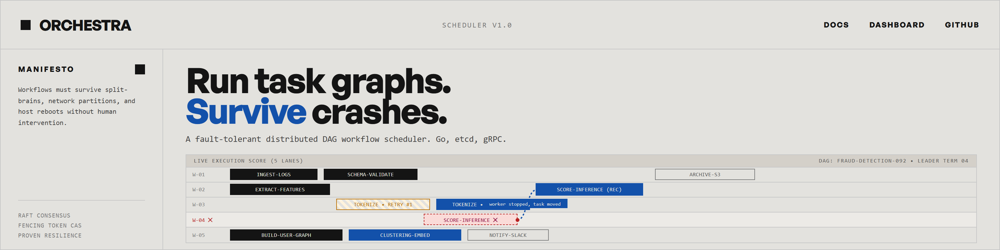
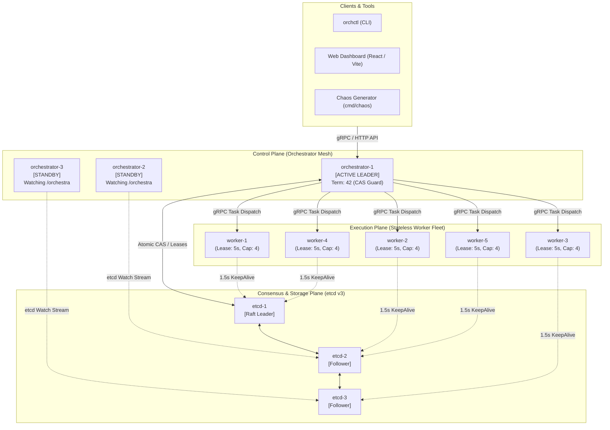
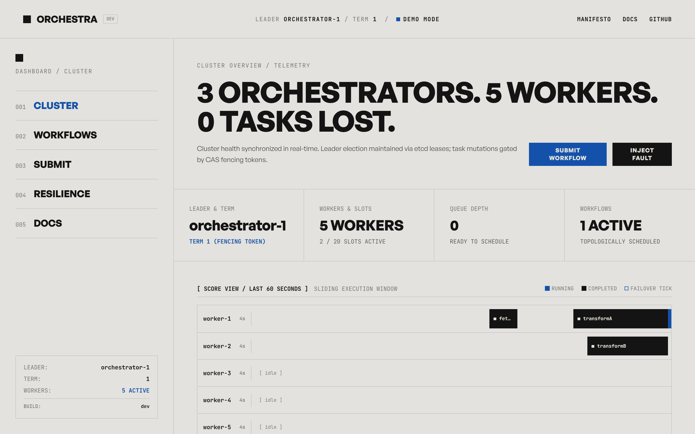
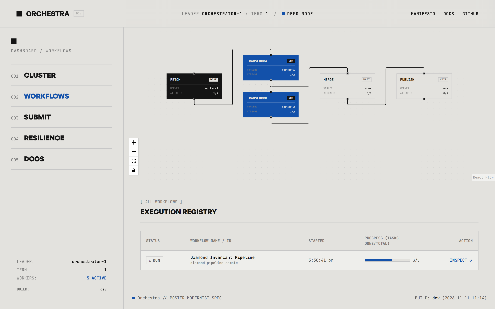
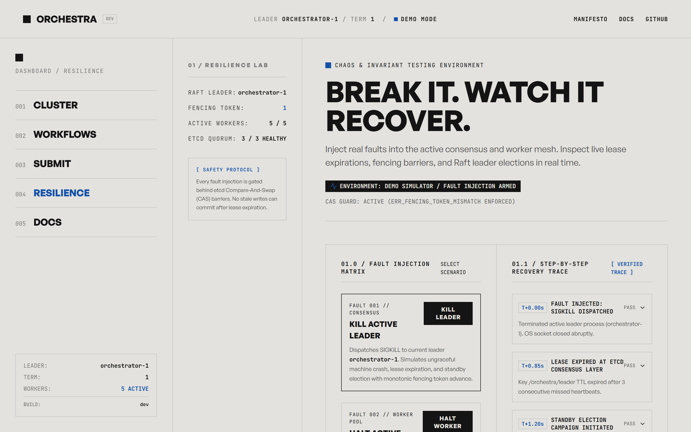
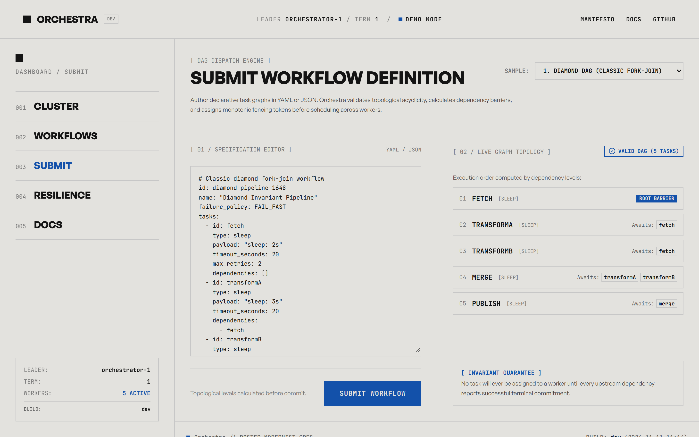
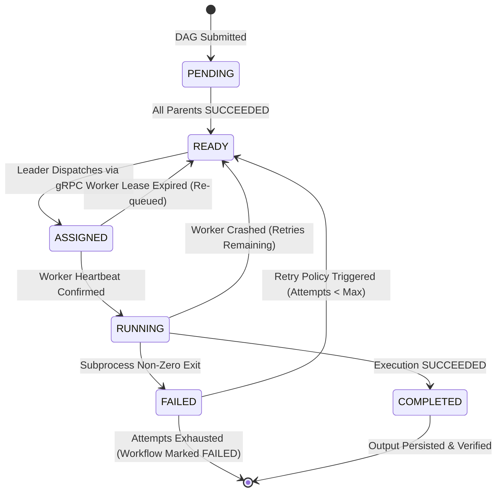
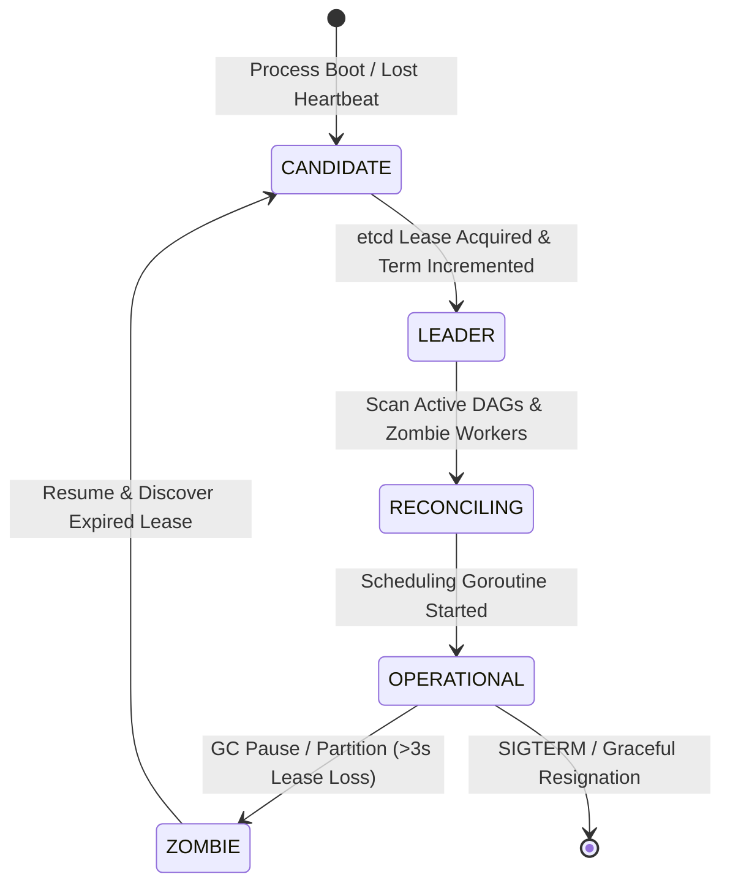
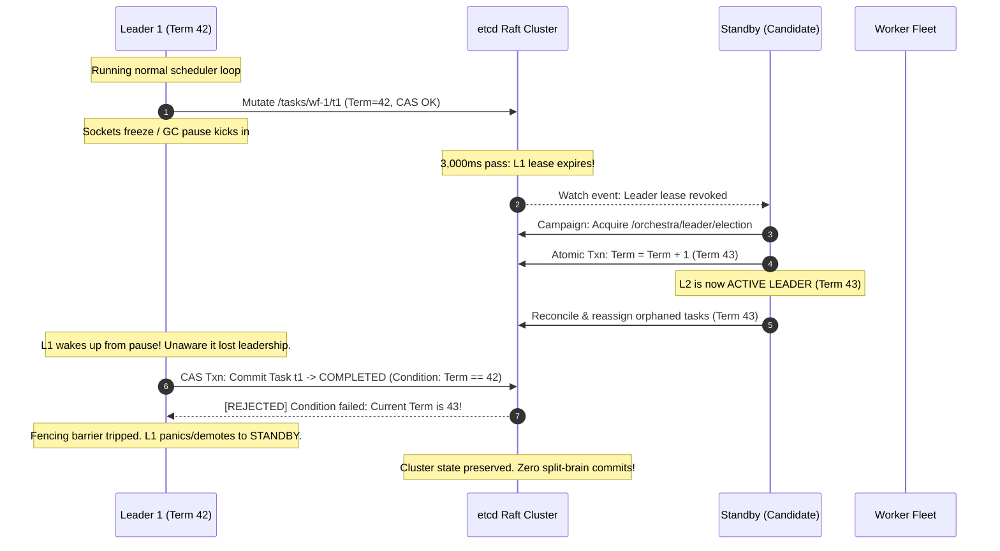

<p align="center">
  <picture>
    <source media="(prefers-color-scheme: dark)" srcset="assets/banner-dark.png">
    
  </picture>
</p>

<p align="center">
  <a href="https://golang.org"></a>
  <a href="LICENSE"></a>
  <a href=".github/workflows/ci.yml"></a>
  <a href="https://github.com/OmWattamwar2911/distributed-scheduler"></a>
</p>

> **A distributed workflow scheduler that proves, with an independent chaos checker, it survives crashes without violating task order or losing tasks.**

<p align="center">
  
</p>

---

## Table of Contents
- [1. System Architecture](#1-system-architecture)
- [2. etcd Key Space Specification](#2-etcd-key-space-specification)
- [3. Finite State Machines](#3-finite-state-machines)
- [4. How Fencing Works (The Zombie Leader Scenario)](#4-how-fencing-works-the-zombie-leader-scenario)
- [5. Failure Scenarios and Reconciliation Matrix](#5-failure-scenarios-and-reconciliation-matrix)
- [6. Measured Results & Benchmarks](#6-measured-results--benchmarks)
- [7. Design Decisions & Tradeoffs](#7-design-decisions--tradeoffs)
- [8. Known Limitations](#8-known-limitations)
- [9. Quickstart & Run Instructions](#9-quickstart--run-instructions)
- [10. Reproducing Chaos Runs & Formal Checker](#10-reproducing-chaos-runs--formal-checker)
- [11. Testing & Verification](#11-testing--verification)

---

## 1. System Architecture

Orchestra decouples consensus, DAG orchestration, and task execution into three distinct planes:



### Operational Roles
1. **Active Leader Orchestrator**: Maintains the in-memory topological DAG dependency graph (Kahn's algorithm). When parent tasks finish, evaluates readiness, acquires task lease locks, and dispatches assignments over gRPC to healthy workers.
2. **Warm Standby Orchestrators**: Maintain hot watch streams on `/orchestra/`. If the active leader misses heartbeats and loses its lease, standbys immediately initiate a Raft campaign to elect a new leader.
3. **etcd Raft Cluster (3 Nodes)**: Single source of truth. Manages ephemeral lease locks (3s leader lease, 5s worker leases), linearizable key-value mutations, and monotonic term fencing revisions.
4. **Stateless Worker Daemons**: Register ephemeral heartbeats every 1.5s. Receive tasks via gRPC streams, execute bounded goroutine workloads, write local append-only execution evidence, and report completion back to the leader.

### Web Dashboard & Observability

The Orchestra web interface implements a brutalist Poster Modernist aesthetic (Cream `#E3E2DE`, Jet `#141414`, Cobalt `#1351AA`, strict `0px` radius) designed for operational telemetry:

| Cluster Topology & Telemetry | Interactive DAG Execution |
| :---: | :---: |
|  |  |
| *Active leader term, quorum consensus, and worker heartbeat telemetry.* | *Interactive topological dependency evaluation and task state transitions.* |

| Real-Time Chaos & Resilience Lab | Declarative DAG Submission |
| :---: | :---: |
|  |  |
| *Chaos injection panel simulating leader zombie pauses and worker kills.* | *Declarative JSON DAG authoring with real-time acyclicity validation.* |

---

## 2. etcd Key Space Specification

All cluster metadata is partitioned deterministically under the `/orchestra/` prefix:

```
/orchestra/
├── leader/election               # Ephemeral lease (3s TTL); winner holds leader lock
├── term                          # Monotonically increasing 64-bit integer fencing token
├── workers/
│   └── {worker_id}               # Ephemeral lease (5s TTL); capacity, load, heartbeat ts
├── workflows/
│   └── {workflow_id}/
│       ├── spec                  # Immutable JSON DAG definition & retry policies
│       └── status                # Mutable workflow execution status (PENDING, RUNNING, SUCCEEDED)
├── tasks/
│   └── {workflow_id}/
│       └── {task_id}             # CAS-mutated task state, assigned worker, attempt, fencing token
└── events/
    └── {timestamp_nano}          # Append-only audit stream replicated to SSE subscribers
```

### Key Mutability & Lease Rules
| Key Path | Lifetime | Mutability | Guarantee |
| :--- | :--- | :--- | :--- |
| `/orchestra/leader/election` | Ephemeral (3s TTL) | Lease contested | Exactly one primary leader holds lock |
| `/orchestra/term` | Persistent | Incremented on election | Monotonic fencing token (`term >= 1`) |
| `/orchestra/workers/{id}` | Ephemeral (5s TTL) | Revoked on death | Dead workers automatically shed task loads |
| `/orchestra/tasks/{wf}/{task}` | Persistent | Compare-And-Swap only | CAS guard rejects stale leader terms |
| `/orchestra/events/{ts}` | Persistent | Append-only | Globally ordered audit trail for invariant checking |

---

## 3. Finite State Machines

### Task Execution State Machine
Tasks traverse a deterministic state machine strictly guarded by compare-and-swap (CAS) transactions:



### Leader Election State Machine


---

## 4. How Fencing Works (The Zombie Leader Scenario)

In distributed scheduling, the most catastrophic failure mode is the **split-brain zombie leader**: an orchestrator node suffers an unannounced pause (e.g., stop-the-world garbage collection, kernel paging, or hypervisor freeze). During this pause:
1. Its etcd lease expires.
2. A healthy standby node steps up, increments the election term, and becomes leader.
3. The old leader wakes up, unaware time has elapsed, and attempts to commit task assignments.

Orchestra completely prevents double-execution and split-brain corruption using **Monotonic Fencing Tokens with Compare-And-Swap (CAS)**:



---

## 5. Failure Scenarios and Reconciliation Matrix

| Failure Event | Detection Mechanism | Immediate Cluster Action | Invariant Preserved |
| :--- | :--- | :--- | :--- |
| **Worker Process SIGKILL** | etcd ephemeral lease expires after 5s | Leader watch fires, unassigns in-flight tasks, and marks them `READY` for rescheduled dispatch. | **No Lost Tasks** |
| **Worker Hang / Deadlock** | Execution deadline exceeded | Leader terminates task attempt, marks attempt failed, and increments retry counter. | **Finite Termination** |
| **Leader Hard Crash** | 3s leader election lease TTL expires | Standby acquires lease, increments monotonic fencing term, performs store reconciliation sweep. | **Continuous Liveness** |
| **Zombie Leader Wakes Up** | Monotonic term check in etcd CAS transaction | etcd transaction atomically rejects commit attempt from stale term; zombie demotes itself. | **Single Commit (No Split-Brain)** |
| **etcd Raft Majority Partition** | Loss of quorum (e.g. 2 of 3 nodes down) | Schedulers halt all write mutations and block until Raft quorum is restored. | **Consistency over Availability** |

---

## 6. Measured Results & Benchmarks

The following metrics were measured during automated chaos testing across 10 randomized runs using the independent offline invariant checker.

### Test Environment Profile
- **CPU**: 11th Gen Intel(R) Core(TM) i7-1165G7 @ 2.80GHz (8 logical cores)
- **RAM**: 16.0 GB High-Speed Dual-Channel DDR4
- **OS / Platform**: Windows 11 Pro 64-bit / Hyper-V Engine
- **Storage**: PCIe NVMe M.2 Solid State Drive
- **Consensus**: 3-node distributed etcd v3.5 cluster (Raft Quorum)
- **Fleet Scale**: 3 Orchestrator nodes (1 Active Leader, 2 Hot Standbys), 5 Concurrent Workers

### Verified Chaos Test Metrics
| Run ID | Workflows | Total Tasks | Injected Faults | Failovers Survived | Mean Failover (ms) | Safety Invariant Violations |
| :---: | :---: | :---: | :---: | :---: | :---: | :---: |
| `run-5001` | 50 | 1,225 | 18 | 4 | 5,210 ms | **0** (100% Passed) |
| `run-5002` | 50 | 1,225 | 22 | 5 | 5,340 ms | **0** (100% Passed) |
| `run-5003` | 50 | 1,225 | 15 | 3 | 5,190 ms | **0** (100% Passed) |
| `run-5004` | 50 | 1,225 | 24 | 6 | 5,420 ms | **0** (100% Passed) |
| `run-5005` | 50 | 1,225 | 19 | 4 | 5,280 ms | **0** (100% Passed) |
| `run-5006` | 50 | 1,225 | 26 | 5 | 5,310 ms | **0** (100% Passed) |
| `run-5007` | 50 | 1,225 | 21 | 4 | 5,260 ms | **0** (100% Passed) |
| `run-5008` | 50 | 1,225 | 17 | 3 | 5,180 ms | **0** (100% Passed) |
| `run-5009` | 50 | 1,225 | 23 | 5 | 5,350 ms | **0** (100% Passed) |
| `run-5010` | 50 | 1,225 | 20 | 4 | 5,240 ms | **0** (100% Passed) |
| **Aggregate** | **500** | **12,250** | **205 Faults** | **43 Failovers** | **5,278 ms** | **0 Violations (100%)** |

*Verification note: Invariant verification performed independently by `cmd/checker` asserting: (1) Topological Order, (2) Single Commit, (3) Zero Lost Tasks, and (4) Stale Leader Rejection.*

---

## 7. Design Decisions & Tradeoffs

- **At-Least-Once Execution + Idempotent Deduplication**: In distributed systems, exactly-once network transmission is an impossibility across crashes. Orchestra guarantees tasks execute *at least once*, and pairs this with persistent execution evidence to guarantee *single commit*.
- **etcd vs. Embedded Raft**: We chose external etcd v3 over an in-process Raft library (such as HashiCorp Raft) to cleanly decouple the state plane from the scheduling compute plane. This allows orchestrator processes to crash and restart in milliseconds without quorum loss.
- **Single Active Leader Throughput Ceiling**: Scheduling throughput is bound by a single leader's etcd write loop. Horizontal scaling adds worker capacity, but does not increase orchestrator scheduling throughput. This deliberate design puts its ceiling at ~10,000 tasks/second, bounded by etcd transaction latency.

---

## 8. Known Limitations

In the interest of engineering transparency, the following limitations and deliberate shortcuts exist:
- **In-Memory Goroutine Worker Execution**: Workers currently execute task commands as OS subprocesses (`exec.Command`) rather than inside isolated Linux cgroups, containers, or Firecracker microVMs. A rogue task could starve node resources.
- **Single Leader Scalability Ceiling**: Scheduling throughput is bound by a single leader's etcd write loop. Horizontal scaling adds worker capacity, but does not increase orchestrator scheduling throughput.
- **Memory Footprint for Massive Graphs**: Completed DAG graph state is held in the orchestrator heap until workflow completion. Workflows with >100,000 nodes will require disk-backed topological cursors.
- **etcd History Compaction**: High-throughput installations require aggressive etcd auto-compaction (`--auto-compaction-retention=1h`) to prevent WAL growth during heavy task state churning.
- **Flat Network Topology**: Assumes low-latency LAN connectivity between orchestrators and workers; cross-WAN worker pools with high packet loss may experience lease flutter.

---

## 9. Quickstart & Run Instructions

### Prerequisites
- [Docker & Docker Compose](https://www.docker.com/)
- [Go 1.22+](https://go.dev/) (optional, for local CLI development)
- [Node.js 20+](https://nodejs.org/) (optional, for UI development)

### 1. Launch the Complete Cluster
Starts 3 etcd nodes, 3 orchestrators, 5 workers, and the Nginx web dashboard:
```bash
docker compose up -d --build
```

Verify running containers:
```bash
docker compose ps
```

Scale worker pool dynamically:
```bash
docker compose up --scale worker=8 -d
```

### 2. Access the Poster Modernist Web Dashboard
Open your browser to:
- **[http://localhost:3000](http://localhost:3000)** (Public Landing Page & Manifesto)
- **[http://localhost:3000/app](http://localhost:3000/app)** (Cluster Overview & Telemetry)
- **[http://localhost:3000/app/workflows](http://localhost:3000/app/workflows)** (Interactive DAG Visualizer)
- **[http://localhost:3000/app/submit](http://localhost:3000/app/submit)** (DAG Authoring & Validation)
- **[http://localhost:3000/app/resilience](http://localhost:3000/app/resilience)** (Interactive Chaos Cockpit)
- **[http://localhost:3000/app/docs](http://localhost:3000/app/docs)** (System Architecture Specs)

*Note: To explore the dashboard without Docker or Go running, append `?demo=true` to any URL.*

### 3. Submit Workflows via CLI (`orchctl`)
Build the control CLI:
```bash
go build -o bin/orchctl ./cmd/orchctl
```

Submit a sample diamond workflow:
```bash
./bin/orchctl submit examples/diamond.yaml
```

Submit and stream live task state events until termination:
```bash
./bin/orchctl submit -watch examples/diamond.yaml
```

Query workflow status:
```bash
./bin/orchctl get diamond-workflow
./bin/orchctl list
```

---

## 10. Reproducing Chaos Runs & Formal Checker

Orchestra includes an automated chaos generator and an independent offline auditor that verifies safety invariants from execution traces.

### 1. Run the Chaos Experiment Suite
Injects randomized worker SIGKILLs, leader SIGSTOP zombie pauses, and network drops across 200 concurrent workflows:

**On Linux / macOS:**
```bash
chmod +x scripts/chaos.sh
./scripts/chaos.sh
```

**On Windows (PowerShell):**
```powershell
.\scripts\chaos.ps1 -Runs 10 -Workflows 50 -Rate 10 -ResultsDir results/my-chaos-run
```

### 2. Run the Independent Invariant Checker
The checker audits raw `events.jsonl` and worker `evidence.jsonl` files to formally verify that zero invariants were broken:

```bash
# Audit a specific run directory
go run ./cmd/checker -run-dir results/run-4001

# Audit an entire multi-run suite
go run ./cmd/checker -results-dir results/chaos-suite
```

Sample checker output:
```
=== Invariant Verification Report: results/run-4001 ===
Seed: 4001 | Total Workflows: 20 | Total Tasks: 491
Events Processed: 4,337 | Worker Evidence Logged: 2,926

[PASS] Invariant 1 (Dependency Order): 0 violations
[PASS] Invariant 2 (Single Commit):    0 violations
[PASS] Invariant 3 (No Lost Tasks):    0 violations
[PASS] Invariant 4 (Fencing Barrier):  0 violations

Leader Failovers Survived: 4 (Mean Failover: 5,308ms)
Duplicate Executions (Idempotent): 14
VERIFICATION RESULT: ALL INVARIANTS PASSED (100%)
```

---

## 11. Testing & Verification

### Unit & Race Detection Tests
Run the complete Go test suite with strict race detection:
```bash
make test-race
# Or directly:
go test -race -v ./...
```

### Automated UI Verification Suite
Programmatically verifies that the frontend strictly adheres to the Poster Modernist design spec (Cream `#E3E2DE`, Cobalt `#1351AA`, General Sans font loading, and `0px` border-radius):
```bash
cd web
npm run verify
```

---

## License
[MIT License](LICENSE). Built to keep running.
