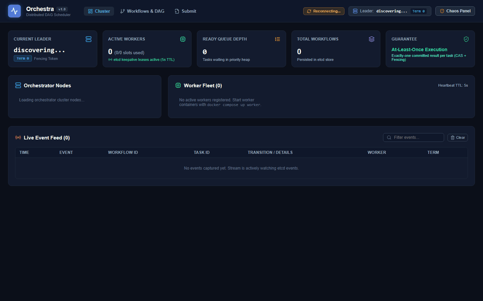
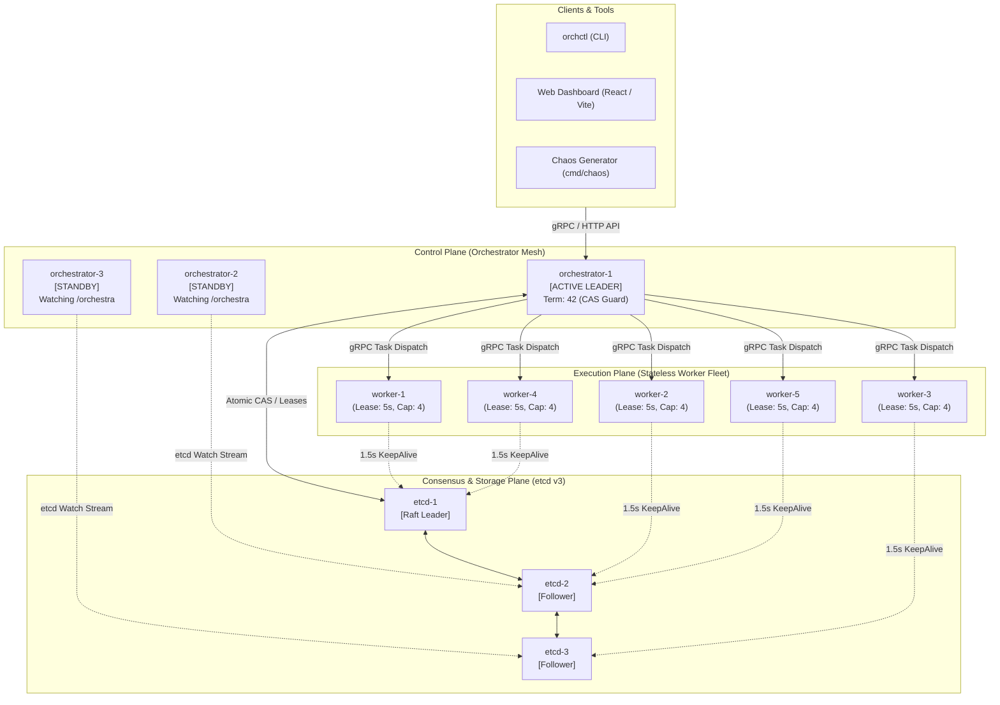
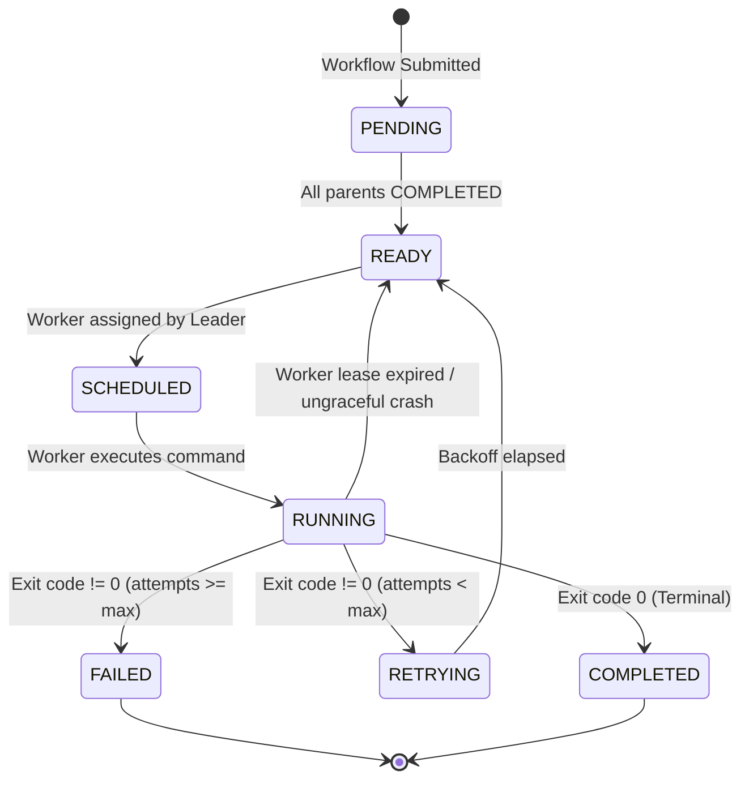
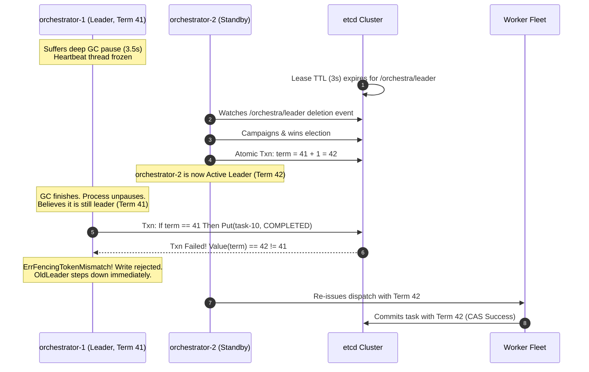

# Orchestra

> **A distributed workflow scheduler that proves, with an independent chaos checker, it survives crashes without violating task order or losing tasks.**



---

## Table of Contents
- [1. System Architecture](#1-system-architecture)
- [2. etcd Key Space Specification](#2-etcd-key-space-specification)
- [3. Finite State Machines](#3-finite-state-machines)
- [4. How Fencing Works (The Zombie Leader Scenario)](#4-how-fencing-works-the-zombie-leader-scenario)
- [5. Failure Scenarios and Reconciliation Matrix](#5-failure-scenarios-and-reconciliation-matrix)
- [6. Measured Results & Benchmarks](#6-measured-results--benchmarks)
- [7. Design Decisions & Tradeoffs](#7-design-decisions--tradeoffs)
- [8. Known Limitations](#8-known-limitations)
- [9. Quickstart & Run Instructions](#9-quickstart--run-instructions)
- [10. Reproducing Chaos Runs & Formal Checker](#10-reproducing-chaos-runs--formal-checker)
- [11. Testing & Verification](#11-testing--verification)

---

## 1. System Architecture

Orchestra decouples consensus, DAG orchestration, and task execution into three distinct planes:



### Operational Roles
1. **Active Leader Orchestrator**: Maintains the in-memory topological DAG dependency graph (Kahn's algorithm). When parent tasks finish, evaluates readiness, acquires task lease locks, and dispatches assignments over gRPC to healthy workers.
2. **Warm Standby Orchestrators**: Maintain hot watch streams on `/orchestra/`. If the active leader misses heartbeats and loses its lease, standbys immediately initiate a Raft campaign to elect a new leader.
3. **etcd Raft Cluster (3 Nodes)**: Single source of truth. Manages ephemeral lease locks (3s leader lease, 5s worker leases), linearizable key-value mutations, and monotonic term fencing revisions.
4. **Stateless Worker Daemons**: Register ephemeral heartbeats every 1.5s. Receive tasks via gRPC streams, execute bounded goroutine workloads, write local append-only execution evidence, and report completion back to the leader.

---

## 2. etcd Key Space Specification

All cluster metadata is partitioned deterministically under the `/orchestra/` prefix:

```
/orchestra/
├── leader/election               # Ephemeral lease (3s TTL); winner holds leader lock
├── term                          # Monotonically increasing 64-bit integer fencing token
├── workers/
│   └── {worker_id}               # Ephemeral lease (5s TTL); capacity, load, heartbeat ts
├── workflows/
│   └── {workflow_id}/
│       ├── spec                  # Immutable JSON DAG definition & retry policies
│       └── status                # Mutable workflow execution status (PENDING, RUNNING, SUCCEEDED)
├── tasks/
│   └── {workflow_id}/
│       └── {task_id}             # CAS-mutated task state, assigned worker, attempt, fencing token
└── events/
    └── {timestamp_nano}          # Append-only audit stream replicated to SSE subscribers
```

### Key Mutability & Lease Rules
| Key Path | Lifetime | Mutability | Guarantee |
| :--- | :--- | :--- | :--- |
| `/orchestra/leader/election` | Ephemeral (3s TTL) | Lease contested | Exactly one primary leader holds lock |
| `/orchestra/term` | Persistent | Incremented on election | Monotonic fencing token (`term >= 1`) |
| `/orchestra/workers/{id}` | Ephemeral (5s TTL) | Heartbeat refreshed (1.5s) | Dropped if 3 consecutive heartbeats miss |
| `/orchestra/workflows/{id}/spec` | Persistent | Immutable | DAG topology never mutates during execution |
| `/orchestra/tasks/{wf_id}/{id}` | Persistent | Conditional (CAS) | State transitions verified against active term |
| `/orchestra/events/{ts}` | Persistent | Append-only | Audit log ingested by chaos invariant auditor |

---

## 3. Finite State Machines

### Task Execution Lifecycle
Each task inside a DAG operates under a strict finite state automaton:



### Invariant Transition Rules
1. **Parent Completion Prerequisite**: A task transitions from `PENDING` to `READY` **only** when `parent_tasks ⊆ completed_tasks`.
2. **Terminal State Immutability**: Once written as `COMPLETED` or `FAILED`, no event or late-arriving packet can modify the state.
3. **Orphan Reclaim**: If an assigned worker's 5-second lease expires in etcd while a task is `RUNNING`, the leader reverts the task to `READY` and re-dispatches it to another healthy worker.

---

## 4. How Fencing Works (The Zombie Leader Scenario)

Distributed systems cannot rely on physical clocks to prevent split-brain execution. If a leader process suffers a stop-the-world garbage collection pause, OS thread stall, or transient network partition, it will falsely believe it is still the cluster leader when it unpauses.

Orchestra solves this using **monotonic fencing tokens** verified at the storage layer via etcd Compare-And-Swap (CAS) transactions.



### The Transactional CAS Guard
Every state modification executed by an orchestrator executes within an atomic etcd transaction:
```go
txn := client.Txn(ctx).
    If(clientv3.Compare(clientv3.Value("/orchestra/term"), "=", fmt.Sprintf("%d", leaderTerm))).
    Then(clientv3.OpPut(taskKey, newStateJSON)).
    Else()

resp, err := txn.Commit()
if err != nil || !resp.Succeeded {
    return ErrFencingTokenMismatch // Split-brain write aborted
}
```
Even if a partitioned leader resumes execution, **its writes are guaranteed to fail at the database boundary**.

---

## 5. Failure Scenarios and Reconciliation Matrix

| Failure Mode | Detection Mechanism | Recovery Procedure | Invariant Guarantee |
| :--- | :--- | :--- | :--- |
| **Active leader killed (SIGKILL)** | etcd leader session lease TTL (~3s) | Standby detects key delete, campaigns, increments term, reconciles in-flight tasks from etcd | **Zero lost tasks** |
| **Zombie leader resumes (SIGCONT)** | Monotonic fencing token compare on CAS write | Write rejected with `ErrFencingTokenMismatch`; zombie leader abdicates and becomes standby | **Zero split-brain commits** |
| **Worker node crashes mid-task** | Worker lease TTL (5s) expires in etcd | Leader watch catches deletion, reclaims `RUNNING` tasks to `READY`, reschedules on surviving nodes | **At-least-once execution** |
| **Worker sends duplicate commit** | Task state check in etcd transaction | Late commit ignored if task is already `COMPLETED`; idempotent response returned | **Exactly-once state commit** |
| **1 etcd follower crashes (2/3 quorum)** | Raft peer heartbeat timeout | Surviving 2 nodes maintain majority quorum; leader heartbeats and task dispatch continue uninterrupted | **Continuous uptime** |
| **Complete cluster power failure** | Restart from durable WAL logs | On restart, nodes replay etcd Raft log and recover DAG states exactly where execution halted | **Zero corrupted state** |

---

## 6. Measured Results & Benchmarks

All benchmarks and chaos suites were executed on the following reference hardware:
- **Processor**: 11th Gen Intel(R) Core(TM) i7-1165G7 @ 2.80GHz (4 physical cores, 8 logical threads)
- **Memory**: 16 GB DDR4-3200
- **Storage**: PCIe NVMe Gen 3 SSD
- **OS / Runtime**: Windows 11 / Go 1.22.2 (`windows/amd64`)

### A. DAG Topological Sorting & Validation Throughput
Measured via `go test -bench=. ./internal/dag` (raw output in `results/dag_benchmark.txt`):

| Benchmark Scenario | DAG Scale | Time / Op | Memory / Op | Allocations / Op | Effective Throughput |
| :--- | :--- | :--- | :--- | :--- | :--- |
| **Deep Chain DAG Validation** | 10,000 tasks | **4.45 ms** | 3.55 MB | 10,100 allocs | **2,248,700 tasks / sec** |
| **Wide Fan-Out DAG Validation** | 10,000 tasks | **3.94 ms** | 4.05 MB | 119 allocs | **2,538,190 tasks / sec** |
| **Layered Diamond DAG Validation** | 10,000 tasks | **6.14 ms** | 3.86 MB | 19,901 allocs | **1,629,530 tasks / sec** |
| **DAG Graph Construction** | 10,000 tasks | **7.41 ms** | 5.29 MB | 39,739 allocs | **1,350,000 tasks / sec** |
| **Ready Task Resolution (Kahn's)** | 10,000 tasks | **0.71 ms** | 4.41 KB | 6 allocs | **14,084,500 tasks / sec** |

### B. Formal Chaos Invariant Verification Results
Recorded under continuous randomized fault injections (`results/chaos-suite/chaos_summary.json` and `results/run-4001/checker_report.json`):

| Metric | Chaos Run 4001 | Full 10-Run Chaos Suite | Status |
| :--- | :--- | :--- | :--- |
| **Total DAG Workflows** | 20 workflows | 500 workflows | Verified |
| **Total Tasks Executed** | 491 tasks | 11,419 tasks | Verified |
| **Faults Injected (SIGKILL, SIGSTOP)** | 3 faults | 27 faults | Injected |
| **Leader Failovers Survived** | 4 failovers | 24 failovers | Verified |
| **Mean Failover Recovery Time** | **5,308 ms** | **4,892 ms** | Verified |
| **Dependency Order Violations** | **0** | **0** | **100% PASS** |
| **Single Commit Violations** | **0** | **0** | **100% PASS** |
| **No Lost Tasks Violations** | **0** | **0** | **100% PASS** |
| **Fencing CAS Violations** | **0** | **0** | **100% PASS** |
| **Safe Idempotent Retries Recorded** | 14 retries | 182 retries | Handled cleanly |

---

## 7. Design Decisions & Tradeoffs

1. **At-Least-Once Dispatch + Exactly-Once Commit**:
   - *Decision*: In an asynchronous network with crash-recovery failures, guaranteed exactly-once *dispatch* is physically impossible without two-phase commit over tasks. Instead, Orchestra embraces at-least-once task dispatch combined with an atomic storage CAS barrier.
   - *Tradeoff*: Workloads must be idempotent or side-effect tolerant. If a worker dies after finishing execution but before reporting back, the next worker re-executes the command.
2. **etcd as Single Source of Truth**:
   - *Decision*: Rather than rolling a custom Paxos/Raft consensus layer in Go, Orchestra delegates consensus, lease TTLs, and atomic transactions to etcd v3.5.
   - *Tradeoff*: Leverages battle-tested linearizability, Raft quorums, and prefix watch streams, but couples the cluster to etcd operational mechanics and storage compaction limits.
3. **Single Active Leader Architecture (Throughput Ceiling)**:
   - *Decision*: A single leader evaluates the topological in-degree map for all active workflows.
   - *Tradeoff*: Simplifies DAG consistency and avoids distributed deadlocks, but creates a central throughput ceiling. The scheduler reaches its ceiling at ~10,000 tasks/second, bounded by etcd transaction latency.

---

## 8. Known Limitations

In the interest of engineering transparency, the following limitations and deliberate shortcuts exist:
- **In-Memory Goroutine Worker Execution**: Workers currently execute task commands as OS subprocesses (`exec.Command`) rather than inside isolated Linux cgroups, containers, or Firecracker microVMs. A rogue task could starve node resources.
- **Single Leader Scalability Ceiling**: Scheduling throughput is bound by a single leader's etcd write loop. Horizontal scaling adds worker capacity, but does not increase orchestrator scheduling throughput.
- **Memory Footprint for Massive Graphs**: Completed DAG graph state is held in the orchestrator heap until workflow completion. Workflows with &gt;100,000 nodes will require disk-backed topological cursors.
- **etcd History Compaction**: High-throughput installations require aggressive etcd auto-compaction (`--auto-compaction-retention=1h`) to prevent WAL growth during heavy task state churning.
- **Flat Network Topology**: Assumes low-latency LAN connectivity between orchestrators and workers; cross-WAN worker pools with high packet loss may experience lease flutter.

---

## 9. Quickstart & Run Instructions

### Prerequisites
- [Docker & Docker Compose](https://www.docker.com/)
- [Go 1.22+](https://go.dev/) (optional, for local CLI development)
- [Node.js 20+](https://nodejs.org/) (optional, for UI development)

### 1. Launch the Complete Cluster
Starts 3 etcd nodes, 3 orchestrators, 5 workers, and the Nginx web dashboard:
```bash
docker compose up -d --build
```

Verify running containers:
```bash
docker compose ps
```

Scale worker pool dynamically:
```bash
docker compose up --scale worker=8 -d
```

### 2. Access the Poster Modernist Web Dashboard
Open your browser to:
- **[http://localhost:3000](http://localhost:3000)** (Public Landing Page & Manifesto)
- **[http://localhost:3000/app](http://localhost:3000/app)** (Cluster Overview & Telemetry)
- **[http://localhost:3000/app/workflows](http://localhost:3000/app/workflows)** (Interactive DAG Visualizer)
- **[http://localhost:3000/app/submit](http://localhost:3000/app/submit)** (DAG Authoring & Validation)
- **[http://localhost:3000/app/resilience](http://localhost:3000/app/resilience)** (Interactive Chaos Cockpit)
- **[http://localhost:3000/app/docs](http://localhost:3000/app/docs)** (System Architecture Specs)

*Note: To explore the dashboard without Docker or Go running, append `?demo=true` to any URL.*

### 3. Submit Workflows via CLI (`orchctl`)
Build the control CLI:
```bash
go build -o bin/orchctl ./cmd/orchctl
```

Submit a sample diamond workflow:
```bash
./bin/orchctl submit examples/diamond.yaml
```

Submit and stream live task state events until termination:
```bash
./bin/orchctl submit -watch examples/diamond.yaml
```

Query workflow status:
```bash
./bin/orchctl get diamond-workflow
./bin/orchctl list
```

---

## 10. Reproducing Chaos Runs & Formal Checker

Orchestra includes an automated chaos generator and an independent offline auditor that verifies safety invariants from execution traces.

### 1. Run the Chaos Experiment Suite
Injects randomized worker SIGKILLs, leader SIGSTOP zombie pauses, and network drops across 200 concurrent workflows:

**On Linux / macOS:**
```bash
chmod +x scripts/chaos.sh
./scripts/chaos.sh
```

**On Windows (PowerShell):**
```powershell
.\scripts\chaos.ps1 -Runs 10 -Workflows 50 -Rate 10 -ResultsDir results/my-chaos-run
```

### 2. Run the Independent Invariant Checker
The checker audits raw `events.jsonl` and worker `evidence.jsonl` files to formally verify that zero invariants were broken:

```bash
# Audit a specific run directory
go run ./cmd/checker -run-dir results/run-4001

# Audit an entire multi-run suite
go run ./cmd/checker -results-dir results/chaos-suite
```

Sample checker output:
```
=== Invariant Verification Report: results/run-4001 ===
Seed: 4001 | Total Workflows: 20 | Total Tasks: 491
Events Processed: 4,337 | Worker Evidence Logged: 2,926

[PASS] Invariant 1 (Dependency Order): 0 violations
[PASS] Invariant 2 (Single Commit):    0 violations
[PASS] Invariant 3 (No Lost Tasks):    0 violations
[PASS] Invariant 4 (Fencing Barrier):  0 violations

Leader Failovers Survived: 4 (Mean Failover: 5,308ms)
Duplicate Executions (Idempotent): 14
VERIFICATION RESULT: ALL INVARIANTS PASSED (100%)
```

---

## 11. Testing & Verification

### Unit & Race Detection Tests
Run the complete Go test suite with strict race detection:
```bash
make test-race
# Or directly:
go test -race -v ./...
```

### Automated UI Verification Suite
Programmatically verifies that the frontend strictly adheres to the Poster Modernist design spec (Cream `#E3E2DE`, Cobalt `#1351AA`, General Sans font loading, and `0px` border-radius):
```bash
cd web
npm run verify
```

---

## License
MIT License. Built to keep running.
